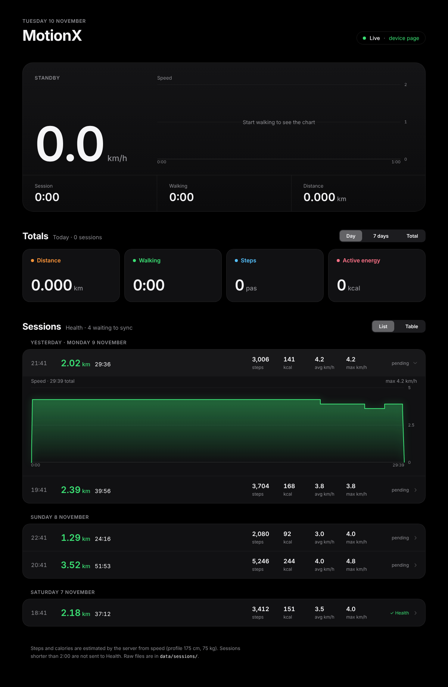
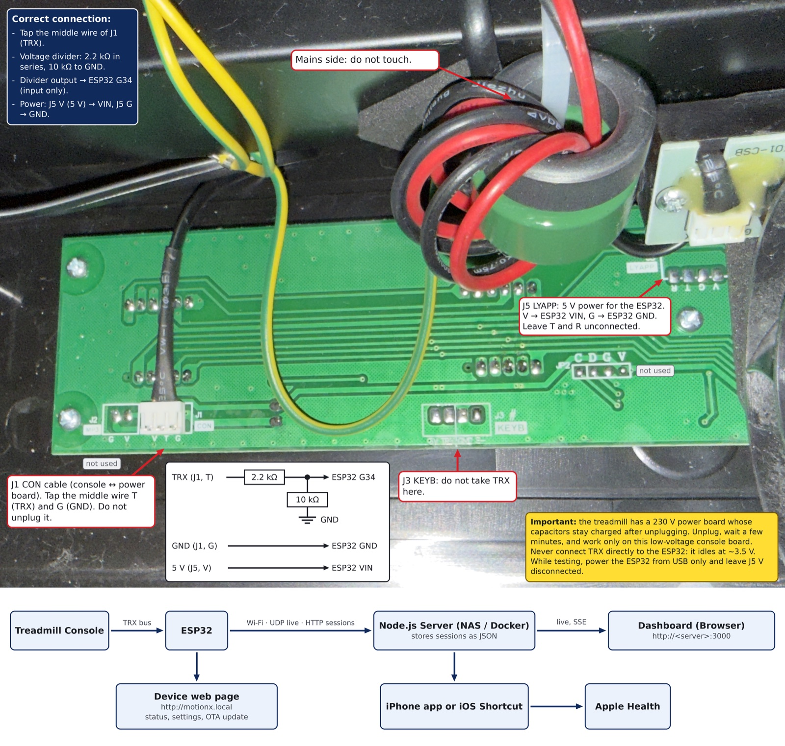

<div align="center">

# 🚶 FlexiSpot MotionX

### Local stats for your walking pad

Turn a FlexiSpot **MotionX** walking pad (Basic, no app) into a connected device.<br>
An ESP32, a tiny self‑hosted server, your walks in Apple Health: no cloud, no account.

[](LICENSE)


[Features](#-features) · [How it works](#-how-it-works) · [Compatibility](#-compatibility) · [Quick start](#-quick-start) · [Docs](#-documentation)

</div>

<br>



Got a MotionX walking pad with no app and no stats? An **ESP32** hidden inside listens to the
treadmill's internal bus, records every session, and sends it over Wi‑Fi to a small server on
your network. You get a live dashboard in your browser, a native iPhone app, and your walks in
**Apple Health**.

## ✨ Features

<table>
<tr>
<td width="50%" valign="top">

**👂 Listens, never talks**<br>
The ESP32 only reads the console → motor bus, on an input‑only pin. Even a firmware bug cannot
send anything to the treadmill.

</td>
<td width="50%" valign="top">

**⏱️ Sessions on autopilot**<br>
Start, speed changes and stop are detected automatically. Each session is stored in the ESP32's
flash and survives power cuts.

</td>
</tr>
<tr>
<td valign="top">

**📊 Live dashboard**<br>
Speed, time and distance update in real time (UDP + Server‑Sent Events), with daily, weekly and
all‑time totals and the history of every session.

</td>
<td valign="top">

**❤️ Apple Health**<br>
Each walk becomes a *Walking* workout with distance, steps and calories, through the iPhone app
or a simple iOS Shortcut.

</td>
</tr>
<tr>
<td valign="top">

**📱 Native iPhone app**<br>
SwiftUI app with a live view, history, background Health sync, and a Live Activity on the lock
screen and Dynamic Island.

</td>
<td valign="top">

**🔧 Built to be closed in**<br>
Over‑the‑air updates with automatic rollback, fallback Wi‑Fi access point, watchdog, safe mode
and remote logs. No need to reopen the treadmill.

</td>
</tr>
<tr>
<td valign="top">

**🏠 No cloud, no account**<br>
The server is a single Node.js file with zero npm packages. It runs on a NAS, a Raspberry Pi or
in Docker, and your data stays as JSON files at home.

</td>
<td valign="top">

**🔬 Documented protocol**<br>
The reverse‑engineered TRX bus is fully described, with a decoder for logic analyzer captures,
so you can check your own model first.

</td>
</tr>
</table>

## 🔌 How it works



- **One wire to tap**: the middle wire (TRX) of the J1 cable, through a two‑resistor voltage
  divider, to ESP32 pin G34. See [hardware.md](docs/hardware.md).
- **Two paths to the server**: live speed over UDP, finished sessions over HTTP, retried until
  the server has them.
- **One page on the device**: `http://motionx.local` shows status, settings and OTA updates.

## 🧩 Compatibility

Developed and tested on a **FlexiSpot MotionX, model WP01B‑EUV2** (manufacturer Ningbo Healthmate), control board **HSM‑W02‑APP‑CONB** (Holtek HT66F3185 MCU), 2026 production.

Other walking pads from the same family (WP01 / WR01 / WR02, often sold under different brands) very likely use the same bus. Check the [protocol](docs/protocol.md) with a logic analyzer before wiring anything.

## 🚀 Quick start

1. **Hardware**: an ESP32 DevKit, two resistors, three wires. See [hardware.md](docs/hardware.md).
2. **Server**:

   ```bash
   cd server && docker compose up -d
   ```

   or, without Docker, `cd server/app && node server.js`.
3. **Firmware**: set Wi‑Fi, server address and admin password at the top of `motionx_v3.ino`, then flash it with Arduino IDE.
4. **Walk**: open `http://<server>:3000`.
5. **Apple Health**: install the [iPhone app](ios), or build the Shortcut from [apple-health.md](docs/apple-health.md).

The full walkthrough, including closing the treadmill, is in [setup.md](docs/setup.md).

## 📚 Documentation

| Path | Content |
|---|---|
| [`docs/hardware.md`](docs/hardware.md) | Boards, wiring, parts list, safety |
| [`docs/setup.md`](docs/setup.md) | Flashing, server, Docker, closing the treadmill |
| [`docs/protocol.md`](docs/protocol.md) | The reverse‑engineered TRX bus protocol |
| [`docs/api.md`](docs/api.md) | HTTP / UDP APIs of the ESP32 and the server |
| [`docs/apple-health.md`](docs/apple-health.md) | The iOS Shortcut, step by step |
| [`firmware/motionx_v3/`](firmware/motionx_v3) | ESP32 firmware (Arduino IDE) |
| [`server/`](server) | Docker Compose file; `app/` holds the Node.js server and the dashboard |
| [`ios/`](ios) | Native iPhone app (SwiftUI) |
| [`tools/motionx_decode.py`](tools/motionx_decode.py) | Decodes a Saleae Logic CSV export of the bus |

## ⚠️ Safety and disclaimer

The treadmill contains a **mains‑powered (230 V) power board** with large capacitors that stay charged after unplugging. Only work on the low‑voltage console board, always unplug the treadmill and wait a few minutes before opening it. Opening the device voids the warranty.

This project is not affiliated with or endorsed by FlexiSpot, Loctek or Ningbo Healthmate. Use it at your own risk.

## 🗺️ Roadmap

- [x] Passive decoding of the TRX bus
- [x] Session storage, Wi‑Fi upload, live dashboard
- [x] Apple Health through an iOS Shortcut
- [x] OTA updates with rollback, fallback AP, watchdog
- [x] Native iOS app (indoor workouts, background sync)
- [ ] Speed calibration (displayed speed vs real belt speed)
- [ ] MQTT / Home Assistant
- [ ] Controlling the treadmill through the unpopulated `J5 LYAPP` header

## 📄 License

[MIT](LICENSE)
