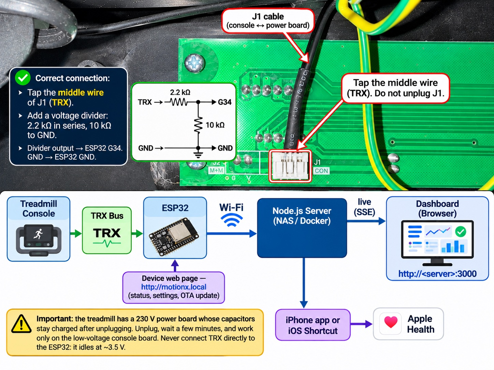

# Hardware

## ⚠️ Read first

- The treadmill has a **230 V power board** with two 400 V capacitors that **stay charged after unplugging**. Unplug, wait a few minutes, and never touch that board.
- Everything in this project happens on the **console board** (green, with the LED displays), which is low voltage and isolated from mains by optocouplers.
- Opening the treadmill voids its warranty.

## Inside the MotionX (WP01B‑EUV2)

| Board | Reference | Role |
|---|---|---|
| Power / motor | `…-F004-DRVB-EM` | mains input, EMI filter, motor driver, current sensor (green toroid + `ISM-T01-CSB`) |
| Console | `HSM-W02-APP-CONB` | Holtek **HT66F3185** MCU, **HT1640S** display driver, buzzer, 433 MHz‑type remote receiver |

The two boards are linked by the **J1 `CON`** cable: 5V / TRX / GND.

## Parts

| Part | Notes |
|---|---|
| ESP32 DevKit (ESP32‑WROOM‑32, 38 pins) | any classic ESP32 board with a USB‑serial chip |
| 2.2 kΩ resistor | series resistor of the divider |
| ~8.8–10 kΩ resistor | bottom of the divider (four 2.2 kΩ in series work fine) |
| wires, heat‑shrink, double‑sided foam | permanent install |
| *optional* 220–470 µF capacitor | on the ESP32 5 V input if you see brown‑out resets |
| *for reverse engineering* 24 MHz 8‑ch USB logic analyzer | the cheap "Saleae Logic" clone works |

## Wiring



```
 J1 CON (console board)                         ESP32 DevKit
 ─────────────────────                          ────────────
   TRX  (middle wire) ──[ 2.2 kΩ ]──┬────────────► G34   (input only)
                                    │
                                 [ 8.8–10 kΩ ]
                                    │
   GND ─────────────────────────────┴────────────► GND

 J5 LYAPP
   V  (5 V) ─────────────────────────────────────► V5 / VIN   (final install only)
   G  (GND) ─────────────────────────────────────► GND
```

- The divider brings the ~3.5 V idle level down to ~2.8 V, safe for the ESP32 (its absolute maximum is 3.6 V).
- **G34 is an input‑only pin**: even a firmware bug cannot drive the treadmill bus.
- While developing, power the ESP32 **from USB only** and leave J5‑V disconnected. Keep the GND link to the treadmill.
- For the final install, power it from **J5‑V** (5 V, sized for FlexiSpot's own Wi‑Fi module) and remove the USB cable.
- Take TRX on the J1 cable, **not** on `J3 KEYB` (see [protocol.md](protocol.md)).

## Permanent install

- **Solder everything.** Breadboards and Dupont wires do not survive treadmill vibrations.
- Insulate the divider (heat‑shrink, or a small piece of perfboard).
- Fix the ESP32 with foam tape, **far from the power board and motor wires**, nothing conductive able to move around.
- Keep the PCB antenna (the zigzag end of the module) clear of metal.

## If you want to control the treadmill one day

The software can come later over Wi‑Fi, but the wires cannot. Before closing the treadmill you would need to:

1. fit **R20 and R21** (100 Ω, 0603/0805) on the console board to connect `J5` T/R to the MCU;
2. run two wires from J5 T/R to the ESP32 through a **bidirectional level shifter** (BSS138 type), since the console runs at 5 V.

None of this is needed for the read‑only setup.
